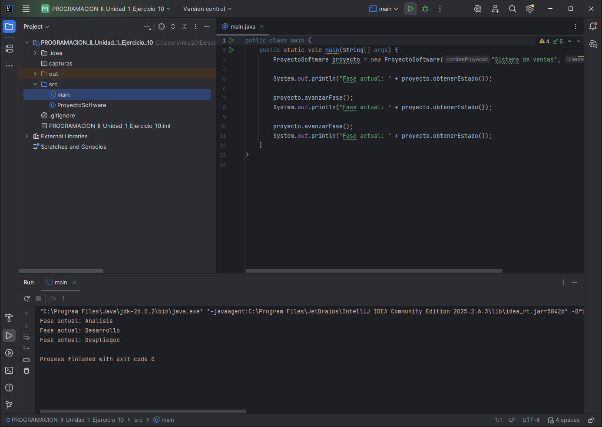

# PROGRAMACIÓN II — Unidad 1, Ejercicio 10: Proyecto de Despliegue de Software

Trabajo práctico de Programación II. Este repositorio contiene la resolución en Java del ejercicio 10 de la Unidad 1.

## Consigna

#### Contexto

En la consultoría IT, los proyectos de software atraviesan diferentes fases (análisis, desarrollo, pruebas, despliegue) que deben ser actualizadas en los sistemas de gestión.

#### Consigna

Modelar una clase en Java que represente un proyecto corporativo de software y permita avanzar su ciclo de vida.

#### Desarrollo requerido

- Definir la clase ProyectoSoftware con atributos nombreProyecto (String), clienteEmpresa (String) y faseActual (int, donde 1=Análisis, 2=Desarrollo, 3=Despliegue).
- Incorporar un constructor que inicie siempre la faseActual en 1.
- Implementar un método avanzarFase() que incremente la fase en 1 (hasta un máximo de 3) y un método obtenerEstado() que devuelva el nombre de la fase en formato texto.
- En el método main, instanciar un proyecto, simular el avance completo del ciclo de vida y mostrar la transición de fases por consola.

## Estructura del repositorio

```
PROGRAMACION_II_Unidad_1_Ejercicio_10/
├── README.md
├── capturas/
│   └── consola.png
└── src/
    ├── main.java   # clase con el método main
    └── ProyectoSoftware.java
```

## Funcionamiento y lógica

### `ProyectoSoftware`

Modela un proyecto con los atributos privados `nombreProyecto`, `clienteEmpresa` y `faseActual`. La fase se guarda como un número: 1 = Análisis, 2 = Desarrollo y 3 = Despliegue.

- **Constructor:** guarda nombre y cliente, y el proyecto siempre arranca en la fase 1.
- **`avanzarFase()`:** suma una fase solo si todavía no se llegó a la 3, así nunca se pasa del despliegue.
- **`obtenerEstado()`:** traduce el número de fase a su nombre con una cadena de `if / else if`.

### `main`

Crea el proyecto "Sistema de ventas" para "Empresa ABC", muestra la fase inicial y avanza dos veces, mostrando cada cambio: **Analisis → Desarrollo → Despliegue**.

## Ejecución

Captura de la consola de IntelliJ IDEA ejecutando el programa:



Salida obtenida:

```
Fase actual: Analisis
Fase actual: Desarrollo
Fase actual: Despliegue
```
